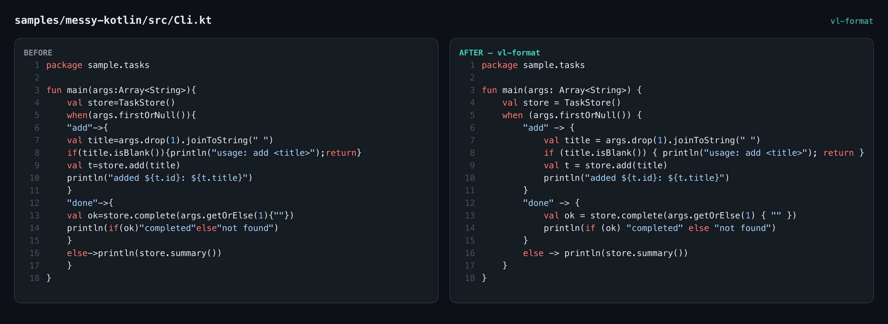
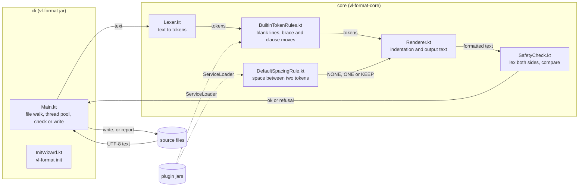

# vl-format

<p align="center"><a href="https://preacherxp.github.io/30-days-of-tools/"></a></p>

<p align="center"><a href="https://buymeacoffee.com/michal.hachula"></a></p>

A code formatter for Kotlin and Java that fixes spacing, indentation and brace placement in place and keeps your line breaks, for JVM projects that want consistent whitespace without adopting a full pretty-printer.

Run `vl-format src/` and it finds every `.kt`, `.kts` and `.java` file below `src/` and formats them in parallel. It puts one space around operators and after commas and keywords, re-indents blocks and wrapped lines, pulls a lone `{` or `else` up onto the line before, collapses runs of blank lines and trims trailing whitespace. It never wraps or joins your lines otherwise. Before it writes a file it lexes the old and new text again and refuses to write if anything other than whitespace changed. `vl-format --check` exits with 2 when a file needs formatting, so it fits in CI and a pre-commit hook. One jar handles both languages, and it checks all 9,638 files of Spring Framework in 0.7 seconds.

<p align="center">){ with no spaces, a when expression whose branches &quot;add&quot;->{ and &quot;done&quot;->{ and their bodies all sit at the same indent as the when, and println(if(ok)&quot;completed&quot;else&quot;not found&quot;) glued together. After, on the right: fun main(args: Array<String>) {, each branch indented under when (args.firstOrNull()) {, each branch body indented under its &quot;add&quot; -> { line, println(if (ok) &quot;completed&quot; else &quot;not found&quot;), and every closing brace aligned with the line that opened it."></p>

## Requirements

- Java 17 or later to run it, on any OS with a JVM
- bash and curl for the installer (macOS and Linux); on Windows run the jar with `java -jar`
- JDK 17 or later to build it; the Gradle wrapper is included and downloads a JDK 17 toolchain if none is installed
- Python 3 and `rsvg-convert` (librsvg) only to regenerate the images in `docs/`

## Install

The installer downloads the jar from the latest GitHub release, checks it against the release's `.sha256` file, saves it as `~/.vl-format/vl-format.jar` and writes a `vl-format` launcher to `~/.local/bin`. It uses no sudo and touches nothing else. Set `VLFORMAT_HOME` or `VLFORMAT_BIN_DIR` to change the two folders.

```sh
curl -fsSL https://raw.githubusercontent.com/preacherxp/vl-format/main/install.sh | bash
curl -fsSL https://raw.githubusercontent.com/preacherxp/vl-format/main/install.sh | bash -s -- v0.1.0   # a specific version
```

Or download `vl-format-X.Y.Z.jar` from the [releases page](https://github.com/preacherxp/vl-format/releases) and run it with `java -jar vl-format-X.Y.Z.jar`.

Or build it from source:

```sh
git clone https://github.com/preacherxp/vl-format.git
cd vl-format
./gradlew :cli:fatJar
java -jar cli/build/libs/vl-format-0.1.0-dev.jar --version
```

Check the version with `vl-format --version`. To update, run the installer again. To uninstall, run `rm -rf ~/.vl-format ~/.local/bin/vl-format`.

## Usage

```sh
vl-format src/                         # format every .kt, .kts and .java file below src/, in place
vl-format --check src/                 # write nothing; exit 2 if any file needs formatting
vl-format --dry-run src/               # write nothing; list the files that would change
vl-format --stdout src/Main.kt         # print one formatted file instead of writing it
vl-format --config ci/.vlformat src/   # use this config file instead of looking for one
vl-format --stats --threads 4 src/     # 4 worker threads, print files/s at the end
vl-format --no-verify src/             # skip the safety check before each write
vl-format init                         # answer a few questions, get a .vlformat in this folder
```

It prints one line per changed file on stdout: `FORMATTED path`, `NEEDS FORMAT path` with `--check` or `WOULD FORMAT path` with `--dry-run`. Errors and refusals go to stderr as `ERROR path: ...`, and lines longer than `maxLineLength` as `LONG LINE path:line (length > max)`. Exit codes are `0` when everything is formatted, `1` for an error or a refused file, and `2` with `--check` when a file needs formatting. Below each folder you give, it skips `.git`, `.gradle`, `.idea`, `build`, `out`, `target` and `node_modules`. Files are read and written as UTF-8 and nothing leaves your machine.

- **Spacing.** One space around binary operators, after commas and keywords, and between `)` and `{`. None inside parentheses, around `.`, `?.`, `::` and `..`, or after a unary `-` or `!`. It knows the language: `val x: Int` but `class A : B`, Java `a ? b : c` but `case X:`, Kotlin `String?`, `x!!`, `as?` and `!in`, Java `T... args` and `non-sealed`.
- **Indentation.** A block body sits 4 spaces past the line that opened its `{`. The contents of an open `(` or `[` sit 8 spaces past the line that opened it, and the closer lines up with that line. A line starting with `.` or an operator, or following a line that ends in one, gets the same 8 spaces. The first line after `if (...)`, `else` or a `->` without a brace gets 4, Java `case` bodies get 4 more than their label, and Kotlin `get()` and `set` lines get 4 under their property.
- **Braces and clauses.** A `{` alone on a line moves up to the end of the line before, and `else`, `catch`, `finally` and the `while` of a do-while move up onto the `}` line. Kotlin reads a newline before `{` differently (`foo()` then `{ ... }` on the next line is a call followed by a lambda), so there it only moves a brace after `if (...)`, `for (...)`, `while (...)`, `when`, `catch (...)`, `else`, `try`, `finally`, `do`, `=`, `->` or a comma, or at the end of a `fun`, `class`, `object` or `interface` line. `when` branches such as `else ->` stay where they are.
- **Blank lines and whitespace.** Runs of blank lines shrink to one, blank lines right after `{` and before `}` go, trailing whitespace goes, the file ends in exactly one newline, and the `*` column of block comments lines up.
- **Left as written.** Your line breaks, the contents of strings, character literals, raw strings and text blocks, the text of comments, and the spacing around `<` and `>`, which can be generics or a comparison.
- **The safety check.** Before writing, it lexes the input and the output and compares them. Every token must be identical (block comments may only change their indentation). No line break may appear, and one may only disappear in front of a `{` or clause it was allowed to move. Pairs where a space changes the meaning must keep their spacing: `>` `=` in `a>=b`, `>` `>` in `x>>2`, a Kotlin `@` label or annotation, `x!! in y`. If anything differs it prints `ERROR path: REFUSED (safety check): ...` and leaves the file alone.

### In CI and git hooks

A pre-commit hook that blocks a commit when a staged file needs formatting, in `.git/hooks/pre-commit` (make it executable). It reads the files as they are on disk, so stage your whole change.

```sh
#!/bin/sh
git diff --cached --name-only --diff-filter=ACM -z -- '*.java' '*.kt' '*.kts' \
  | xargs -0 -r vl-format --check
```

A GitHub Actions step that fails the build when anything needs formatting:

```yaml
- uses: actions/setup-java@v4
  with: { distribution: temurin, java-version: 17 }
- run: curl -fsSL https://raw.githubusercontent.com/preacherxp/vl-format/main/install.sh | bash
- run: ~/.local/bin/vl-format --check src/
```

## Configuration

Put a `.vlformat` file (Java properties) in your project. For each file it formats, vl-format uses the nearest `.vlformat` in that file's folder or any folder above it, so a subproject can have its own. `--config <path>` uses one file for everything instead. `vl-format init` asks for each value and writes a commented `.vlformat`; [`.vlformat.example`](.vlformat.example) has every key. The defaults:

```properties
indentSize=4
continuationIndent=8
maxBlankLines=1
maxLineLength=0
attachBraces=true
attachClauses=true
insertFinalNewline=true
alignCommentStars=true
# disabledRules=blank-lines,attach-braces,attach-clauses,default-spacing
```

- **`continuationIndent`** is the extra indent for wrapped lines and the contents of an open `(` or `[`.
- **`maxLineLength`** reports longer lines on stderr and never changes them. `0` turns the report off.
- **`attachBraces`** and **`attachClauses`** turn off moving `{` and `else`/`catch`/`finally` up.
- **`alignCommentStars`** turns off re-indenting the `*` column of block comments.
- **`disabledRules`** turns off rules by name. The built-in ones are `blank-lines`, `attach-braces`, `attach-clauses` and `default-spacing`; without `default-spacing` every space stays as you wrote it.

A key it doesn't know, or a value it can't read, falls back to the default without a warning.

### Plugins

A plugin can change two things: what goes between two tokens on the same line (a `SpacingRule` that returns `NONE`, `ONE`, `KEEP` or `UNSPECIFIED`), and the token list before it is rendered (a `TokenRule`). Spacing rules are asked in `order`; the first answer that isn't `UNSPECIFIED` wins and the built-in table sits at 100, so a rule with a lower number overrides it. The indentation itself is not pluggable. Implement `dev.vlformat.rules.RuleProvider`, list the class in `META-INF/services/dev.vlformat.rules.RuleProvider`, and put the jar on the classpath:

```sh
VLFORMAT_PLUGINS=tight-control.jar vl-format src/                                 # with the installed launcher
java -cp vl-format-0.1.0-dev.jar:tight-control.jar dev.vlformat.cli.MainKt src/   # without it
```

`java -jar` ignores the classpath, so plugins don't load that way. A plugin's rules can be turned off in `.vlformat` by name like the built-in ones, and the safety check refuses any change a plugin makes to tokens, comments included, so a rule that rewrites them needs `--no-verify`. To call the formatter from your own code, use `Formatter(config, extraTokenRules, extraSpacingRules).format(source, Language.KOTLIN)` from the `core` module; one instance is safe to share between threads.

## Measured

On an Apple M4 Pro (12 cores, 48 GB) with macOS 26.6 and Temurin 22.0.2, checking the default branch of five public projects, 17,330 files and about 100 MB in total. Times are wall clock for `vl-format --check` through the installed launcher, best of three, JVM start included.

| Project | Files | Time |
| --- | --- | --- |
| OkHttp | 691 | 0.17 s |
| kotlinx.coroutines | 1,104 | 0.16 s |
| Ktor | 2,628 | 0.28 s |
| Guava | 3,269 | 0.38 s |
| Spring Framework | 9,638 | 0.71 s |
| All five | 17,330 | 1.1 s |

That is 18,000 to 22,000 files a second with the safety check and about 32,000 without it, measured inside the process with `--stats`. Plain `java -jar` is slower to warm up: 2.4 seconds for all five, about 9,000 files a second. The launcher runs Java with `-XX:+UseSerialGC -XX:TieredStopAtLevel=1`, which suits a short run; pass the same flags to `java -jar` to get the faster numbers.

Every file, plus 32 in `out` and `target` folders the CLI skips, was then checked with the real parsers, javac's for Java and the Kotlin compiler's for Kotlin: nothing crashed, the safety check refused nothing, formatting a second time changed nothing, and every file parsed to the same tree as before. Before the fixes that went into this version, 27 of those files came out broken and the safety check had missed all of them, from Java hexadecimal floats such as `0x1.0p31` to Kotlin `$$"..."` strings and `x!! in y`. `./gradlew :corpus-check:run` repeats the check on any folder.

## Limits

- It works on tokens, not a syntax tree. It never wraps a long line, never joins lines (apart from the brace and clause moves above), and doesn't sort or remove imports, add braces, or change parentheses, trailing commas or semicolons.
- `<` and `>` keep the spacing you wrote, because a lexer can't tell `List<String>` from `a < b`. `if (a<b)` stays as it is.
- The layout is its own. ktfmt and google-java-format parse each file and print it again in one fixed style, wrapping long lines; ktlint parses Kotlin with the compiler's parser and also checks naming, imports and many other rules. vl-format does less: whitespace only, in both languages, keeping your line breaks. On code those tools already formatted it still changes lines, even set to their indent (`indentSize=2`, `continuationIndent=4`): 3.5% of Guava's lines and 19.7% of OkHttp's, mostly wrapped parameter lists. Use one formatter per codebase.
- In Kotlin, a `{` alone on the line after a call or a property stays there, because moving it would turn a lambda into an argument.
- Indentation follows a few rules, not the grammar. Only the first line of a brace-less `if` body gets the extra level, and a Kotlin `get()` or `set` is only indented when it comes straight after a property in a class body or at the top of a file.
- Output uses LF line endings and spaces: a file with CRLF comes out with LF and tab indentation becomes spaces. A UTF-8 byte order mark stays. Files that aren't valid UTF-8 are reported and skipped.
- In block comments, trailing spaces are removed and lines starting with `*` are re-indented; the text is unchanged. Other comment lines keep their indentation.
- The safety check reads the output with the same lexer as the formatter, so a lexing mistake made the same way on both sides gets past it. The corpus run above, with the real parsers, exists for that reason.
- The installer and the `core` library on GitHub Packages need a tagged release. GitHub Packages asks for a GitHub token even to download public packages.

## Architecture



- **`core/.../lexer/Lexer.kt`** splits the source into tokens in one pass. Spaces are not tokens; each token records whether a space came before it, and line breaks are tokens so rules can move them. Strings with `${...}` templates, Kotlin `$$"..."` strings, raw strings, text blocks and nested Kotlin comments are single tokens, so nothing inside them is ever touched. It never joins `>` with the next character into `>=`, `>>` or `>>>`, so `List<List<String>>` can't break.
- **`core/.../rules/BuiltinTokenRules.kt`** removes extra blank lines and moves `{` and clause keywords up. `LineJoins` in the same file is the one list of places a line break may be removed, used both by these rules and by the safety check, because in Kotlin a line break can change what the code means.
- **`core/.../rules/DefaultSpacingRule.kt`** decides the space between each pair of tokens on a line from the two tokens and a short look back (is this colon in a class header, is this `-` unary). It answers `KEEP` where a lexer can't know, as with `<` and `>`.
- **`core/.../engine/Renderer.kt`** writes the result into one `StringBuilder` sized to the input. It keeps a stack of open `{`, `(` and `[`, each remembering the indent of the line that opened it, so a block opened on a wrapped line is indented from that line.
- **`core/.../engine/Formatter.kt`** puts the pipeline together, loads plugins and is the API for other programs. **`SafetyCheck.kt`** runs the comparison described in Usage.
- **`cli/.../Main.kt`** walks the folders, finds each file's `.vlformat` (cached per folder), formats on a thread pool with one thread per core, runs the safety check and writes or reports.
- **`corpus-check/`** is a development tool, not part of the jar: it formats folders in memory and compares the parse trees from javac and the Kotlin compiler before and after.

## Development

```sh
./gradlew test                       # 214 tests: lexer, spacing, indentation, fixtures, fuzzing, safety check, CLI
./gradlew :cli:fatJar                # builds cli/build/libs/vl-format-0.1.0-dev.jar
./samples/run-demo.sh                # formats a scratch copy of samples/, shows the diff, checks a second run changes nothing
./gradlew :corpus-check:run --args="/abs/path/to/repo"   # format a tree in memory, compare javac and Kotlin parse trees
python3 tools/render_comparison.py samples/messy-kotlin/src/Cli.kt docs/hero.png "samples/messy-kotlin/src/Cli.kt"
```

The tests need nothing beyond the JDK. `core/src/test/resources/fixtures/` holds input files and the output they must produce; `CorpusRegressionTest` has one test for each bug the corpus run found. `samples/` holds two deliberately messy projects, and `tools/render_comparison.py` formats one of their files with the built jar and draws the before and after side by side as SVG and PNG, which is how `docs/hero.png` is made. `corpus-check` only parses the folders you give it; it never compiles or runs their code.

The version is `0.1.0-dev` in `build.gradle.kts`. Pushing a tag such as `v0.1.0` runs `.github/workflows/release.yml`, which builds that version, attaches the jar, its `.sha256` and `install.sh` to a GitHub release and publishes `core` to GitHub Packages.

## License

[MIT](LICENSE)

<sub>If it keeps one more whitespace-only diff out of your code review, you can [buy me a coffee](https://buymeacoffee.com/michal.hachula).</sub>
