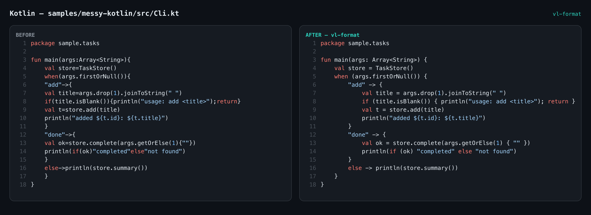
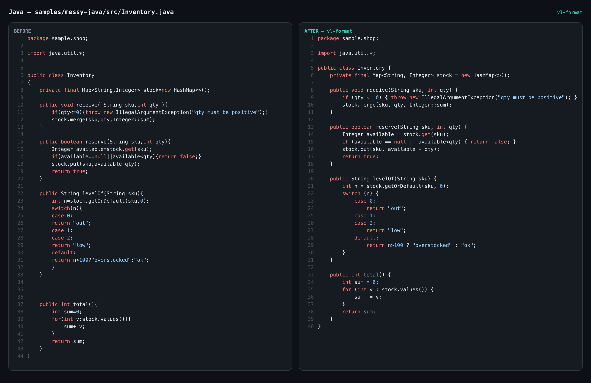

# vl-format

Fast, extensible code formatter for **Kotlin** and **Java**.





(Regenerate with `python3 tools/render_comparison.py <file> <out.png> [title]` —
formats the file with the built jar and renders both versions side by side.)

- **Performance-first**: single-pass lexer, no AST, one `StringBuilder` per file,
  parallel file processing. ~4,000 files/s with safety verification on,
  ~9,000 files/s in check mode (laptop, typical source files).
- **Safe by construction**: string literals, char literals, and comment bodies
  are preserved byte-for-byte; anything the lexer doesn't understand passes
  through verbatim. Formatting is idempotent (verified by tests). On top of
  that, every changed file passes a **token-safety verification** before it is
  written: input and output are re-lexed and compared token-by-token — if the
  significant token stream differs in any way, vl-format refuses to write and
  reports the divergence (`--no-verify` opts out).
- **Extensible**: every formatting decision flows through ordered rule chains
  you can override, add to, or disable — programmatically or via
  `ServiceLoader` plugins, with zero changes to vl-format itself.

## Install

**One-liner** (needs Java 17+ and curl; installs to `~/.local/bin/vl-format`):

```bash
curl -fsSL https://raw.githubusercontent.com/purecode-projects/vl-format/main/install.sh | bash
```

Pin a version: `... | bash -s -- v0.1.0`. Uninstall:
`rm -rf ~/.vl-format ~/.local/bin/vl-format`.

**Manual**: grab `vl-format-X.Y.Z.jar` from the
[releases page](https://github.com/purecode-projects/vl-format/releases) and run it with
`java -jar`.

**From source**:

```bash
git clone https://github.com/purecode-projects/vl-format && cd vl-format
./gradlew :cli:fatJar        # -> cli/build/libs/vl-format-*.jar
./samples/run-demo.sh        # see it work on the sample projects
```

**As a library / for plugin authors** — `vl-format-core` is published to
GitHub Packages on every release:

```kotlin
dependencies {
    implementation("dev.vlformat:vl-format-core:<version>")
}
```

## Usage

```bash
vl-format src/                        # format a tree in place
vl-format --check src/                # CI gate: exit 2 if anything is dirty
vl-format --dry-run src/              # list files that would change
vl-format --stdout Main.kt            # preview one file on stdout
vl-format --config ci/.vlformat src/  # explicit config
vl-format --stats --threads 8 src/    # timing + throughput
vl-format init                        # interactive config creator (writes .vlformat)
```

```
Options:
  --check         Don't write; exit 2 if any file needs formatting
  --dry-run, -n   Don't write; list files that would change
  --stdout        Format a single file to stdout
  --config <p>    Use an explicit .vlformat properties file
  --threads <n>   Worker threads (default: CPU cores)
  --no-verify     Skip the token-safety verification pass
  --stats         Print timing and throughput
```

Directories are walked recursively for `.java`, `.kt`, `.kts`; `build/`,
`.git/`, `target/`, `node_modules/` etc. are skipped. Exit codes: `0` clean,
`1` error, `2` (`--check`) formatting needed.

**Pre-commit hook** (`.git/hooks/pre-commit`):

```bash
#!/bin/sh
git diff --cached --name-only --diff-filter=ACM | grep -E '\.(java|kt|kts)$' \
  | xargs -r vl-format && git update-index --again
```

**GitHub Actions gate**:

```yaml
- uses: actions/setup-java@v4
  with: { distribution: temurin, java-version: 17 }
- run: |
    curl -fsSL https://raw.githubusercontent.com/purecode-projects/vl-format/main/install.sh | bash
    ~/.local/bin/vl-format --check src/
```

## Releasing (maintainers)

CI (`.github/workflows/ci.yml`) builds, tests, and runs the sample demo on
every push/PR. To cut a release:

```bash
git tag v0.2.0 && git push origin v0.2.0
```

`release.yml` then builds with the tag version, attaches the fat jar +
sha256 + `install.sh` to a GitHub Release, and publishes `vl-format-core`
to GitHub Packages.

## What it does

- Normalizes spacing around operators, commas, colons, keywords, parens,
  braces (language-aware: `val x: Int` vs `class A : B`, Java ternary vs
  `case X:`, Kotlin `?.`/`?:`/`!!`/ranges, Java varargs `T... args`).
- Re-indents with a frame stack anchored to opener lines: block bodies sit
  `indentSize` (default 4) past the line that opened the `{`, multi-line call
  arguments sit `continuationIndent` (default 8) past the line that opened the
  `(`, and closers align back to their opener's line — so constructs opened on
  wrapped/continuation lines nest correctly. Leading `.`-chains and trailing
  binary operators get continuation indent; Java colon-switch bodies get an
  extra level.
- Attaches `{` to the previous line and `else`/`catch`/`finally`/do-while
  `while` to `}` (both toggleable). Kotlin `when` branches are left alone.
- Collapses blank-line runs, trims trailing whitespace, aligns `*` gutters in
  Javadoc/KDoc, guarantees a single final newline.

Ambiguity policy: at token level `<`/`>` may be generics, comparison, or shift
halves — vl-format **keeps the author's spacing** there rather than guess wrong
(one exception: `Map<K, V>=x` is provably an assignment and gets its space).
This is why it can never corrupt `List<List<String>>`.

## Configuration

Run `vl-format init` for an interactive creator (indent size, continuation
indent, max line length, blank lines, brace attachment, …) — it writes a
commented `.vlformat`, with sane defaults on Enter.

Or drop a `.vlformat` (Java properties) in your project root by hand — see
[`.vlformat.example`](.vlformat.example). Discovery walks up from each file, so
nested projects can carry their own style. `--config` overrides discovery.

`maxLineLength` (default off) reports over-long lines to stderr as
`LONG LINE path:line (len > max)`; it never fails the run and never re-wraps —
wrapping decisions stay yours.

## Architecture

```
core/
  lexer/    Token, Lexer        — source → tokens (whitespace-free, newline-aware)
  rules/    TokenRule           — stream rewrites (blank lines, brace attachment, …)
            SpacingRule         — per-token-pair spacing decisions, chained by order
  engine/   Renderer            — indentation + spacing chain → output text
            Formatter           — pipeline assembly, plugin discovery, public API
            SafetyCheck         — token-equivalence verifier (input vs output)
cli/        parallel walker, check/write modes, safety gate, stats
```

Pipeline: **lex → token rules (ordered) → render**. The renderer consults the
spacing chain for every adjacent token pair; first non-`UNSPECIFIED` decision
wins (`NONE` / `ONE` / `KEEP` author spacing). The built-in table sits at order
100, so any custom rule with a lower order overrides it.

## Extending

Programmatic:

```kotlin
val formatter = Formatter(
    extraSpacingRules = listOf(object : SpacingRule {
        override val name = "tight-braces"
        override val order = 10
        override fun spaceBetween(tokens: List<Token>, l: Int, r: Int, ctx: RuleContext) =
            if (tokens[r].type == TokenType.LBRACE) SpaceDecision.NONE
            else SpaceDecision.UNSPECIFIED
    }),
)
```

As a drop-in plugin jar: implement `dev.vlformat.rules.RuleProvider`, list the
implementation class in
`META-INF/services/dev.vlformat.rules.RuleProvider`, put the jar on the
classpath. Users can disable any rule (built-in or plugin) by name via
`disabledRules` in `.vlformat`.

`Formatter` instances are immutable and thread-safe.

## Testing

```bash
./gradlew test
```

180+ tests across seven core suites plus CLI integration tests:

- Lexer unit + edge tests (templates, raw strings, text blocks, nested
  comments, numbers, operator munching, backtick identifiers, CRLF/BOM,
  unterminated constructs, unicode).
- Formatting behavior tests (spacing, indentation, attachment rules) plus
  dedicated spacing/indent edge suites (labels, callable references, wildcard
  generics, `non-sealed`, array initializers, arrow switches, deep nesting,
  unbalanced input).
- Seeded fuzzing: 800+ generated programs and whitespace-mangled variants per
  run, every sample checked for idempotency, token safety, and EOF hygiene.
- Malformed-input suite: garbage, operator soup, unterminated everything —
  never crashes, never changes tokens.
- Dogfood test: vl-format formats its own source tree safely.
- Golden-file fixtures (`core/src/test/resources/fixtures/`): each
  `*.input.*` must produce `*.expected.*`, every expected file must be a fixed
  point (idempotency), and no string literal may ever be altered.
- Config parsing/discovery and extensibility (custom rules, ordering,
  disabling) tests.
- Safety-check tests (dropped tokens, changed literals, legal whitespace moves)
  and CLI integration tests (check/write/dry-run/stdout modes, config
  discovery, exit codes, skip dirs).
- `samples/` holds two deliberately messy projects; `samples/run-demo.sh`
  formats a scratch copy, diffs, and proves the second run is a no-op.
- Battle-tested against real-world sources (okio `Buffer.kt`, okhttp
  `HttpUrl.kt`, guava `ImmutableMap.java`, …): verification clean, idempotent.

## Known limitations (v0.1)

- No automatic line wrapping; existing line breaks are respected
  (`maxLineLength` reports offenders so you can wrap deliberately).
- `<`/`>` spacing is preserved rather than normalized (see ambiguity policy).
- Shift operators render as authored (`>>` is never fused during lexing).
- No AST: it cannot reorder imports or rewrite syntax — by design.
